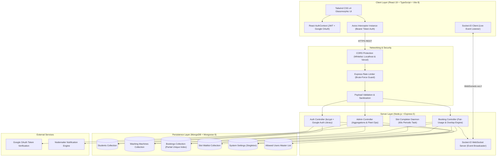
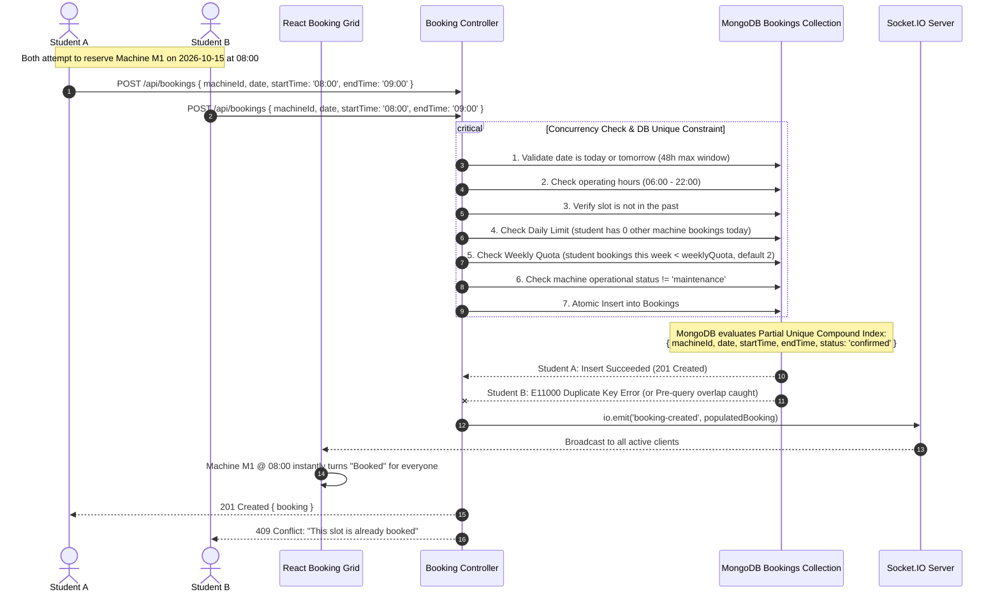
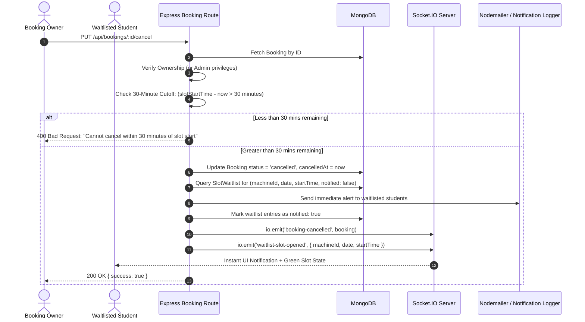
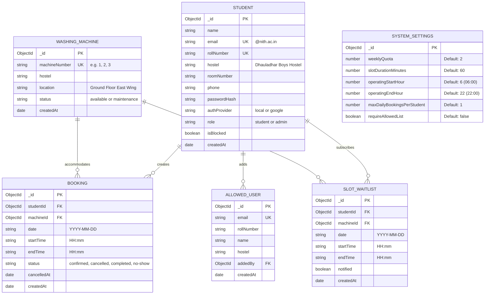

# 🧺 Dhauladhar Boys Hostel (DBH) Laundry Booking System

[](https://react.dev/)
[](https://www.typescriptlang.org/)
[](https://vitejs.dev/)
[](https://tailwindcss.com/)
[](https://expressjs.com/)
[](https://nodejs.org/)
[](https://www.mongodb.com/)
[](https://socket.io/)
[](https://developers.google.com/identity)

> **A real-time, concurrency-safe, institutional laundry slot management platform engineered for the 500+ residents of Dhauladhar Boys Hostel at National Institute of Technology (NIT) Hamirpur.**

---

## 📌 Executive Summary & Problem Statement

In high-density university hostels, shared laundry facilities suffer from chronic operational friction:
1. **Unregulated Physical Queuing & Hostile Collisions**: Students physically leave buckets or clothes in front of machines, leading to disputes over turn ownership.
2. **Resource Monopolization**: A minority of students book back-to-back hours or multiple machines on the same day, leaving others without laundry access.
3. **Machine Breakdown Blindspots**: When a machine malfunctions, students only discover it upon arrival with wet laundry.
4. **Phantom Bookings & No-Shows**: Students reserve slots they never utilize, idling high-demand machines.

### 💡 The Solution
The **DBH Laundry Booking Platform** digitizes the entire machine lifecycle through:
- **Instant Grid Synchronization**: WebSockets (Socket.IO) broadcast bookings and cancellations across all connected clients in sub-100ms real-time.
- **Race Condition Prevention**: Database-level compound partial unique indexes eliminate double-booking at the millisecond level.
- **Institutional Guardrails**: Mandatory `@nith.ac.in` domain validation, Google OAuth ID token server verification, and optional hostel master allowed-list verification.
- **Fair-Usage Algorithm**: Configurable weekly booking caps, single-machine-per-day locks, 48-hour forward booking horizons, and 30-minute cancellation cutoffs.
- **Dynamic Slot Waitlist**: Real-time notifications and automated email dispatches when a reserved slot is released.
- **Autonomous Daemon**: An asynchronous cron-like background worker auto-expires past bookings every 60 seconds without manual intervention.

---

## 🏗️ High-Level System Architecture



---

## 🔄 End-to-End Core Workflows

### 1. Authentication & Institutional Access Control Flow

```mermaid
sequenceDiagram
    autonumber
    actor Student
    participant Frontend as React Client
    participant API as Express Auth Route
    participant Google as Google OAuth2 API
    participant DB as MongoDB (Students & AllowedUsers)

    alt Local Credentials
        Student->>Frontend: Enters Name, @nith.ac.in Email, Password, Room, Phone
        Frontend->>API: POST /api/auth/register
        API->>DB: Check AllowedUser whitelist (if enforced)
        API->>DB: Check if email/roll number already exists
        API->>API: Hash password via bcrypt (10 salt rounds)
        API->>DB: Save Student document
        API->>Frontend: Return Signed JWT (7d expiry) + Student profile
    else Google One-Tap OAuth
        Student->>Frontend: Clicks "Continue with Google"
        Frontend->>Google: Authenticate & receive ID Credential Token
        Frontend->>API: POST /api/auth/google { credential }
        API->>Google: client.verifyIdToken({ idToken, audience })
        Google-->>API: Validated Payload (email, name)
        API->>API: Verify email ends with "@nith.ac.in"
        alt New User (Missing room/phone)
            API-->>Frontend: 202 Accepted { requireExtraDetails: true }
            Student->>Frontend: Inputs Roll Number, Room Number, Phone
            Frontend->>API: POST /api/auth/google { credential, extraDetails }
        end
        API->>DB: Upsert Student with authProvider: 'google'
        API->>Frontend: Return Signed JWT + Student profile
    end
    Frontend->>Frontend: Save JWT in localStorage; Axios sets Authorization Header
```

---

### 2. Slot Reservation & Concurrency Prevention Engine

When hundreds of students compete for weekend morning slots, two students could click "Book" simultaneously. The system executes a multi-stage validation pipeline backed by an atomic database constraint:



---

### 3. Slot Cancellation & Real-Time Waitlist Escalation Flow

To prevent machine wastage, slots have strict cancellation rules and an automated escalation system for waitlisted students:



---

### 4. Background Slot Auto-Completion Daemon

Instead of waiting for user interaction to clean up expired slots, the backend runs an internal periodic scheduler:
- **Trigger**: Runs synchronously on server bootstrap, and every **60 seconds** via `setInterval(completeExpiredBookings, 60000)`.
- **Query Logic**:
  ```javascript
  Booking.updateMany(
    {
      status: 'confirmed',
      $or: [
        { date: { $lt: todayStr } },
        { date: todayStr, endTime: { $lte: currentTime } }
      ]
    },
    { $set: { status: 'completed' } }
  );
  ```
- **Impact**: Zero stale "confirmed" reservations occupying past slots. Historical statistics, completed counts, and student quotas remain 100% accurate.

---

### 5. Physical Verification via QR Code Handshake

1. **Student Side**: Upon slot confirmation, the student navigates to their **Dashboard** or **Booking Confirmation Modal**. The frontend uses `react-qr-code` to render a high-contrast QR code encoding the unique MongoDB `_id` of the booking.
2. **Hardware / Guard Side**: The hostel caretaker or admin accesses the **Check-in Console (`/admin/scanner`)**.
3. **Execution**: The admin scans or inputs the Booking ID, triggering `POST /api/bookings/:id/checkin`. The server verifies that the booking is active, matches current time parameters, and marks arrival.

---

### 6. Admin Control Center & Fleet Governance

Admins have full oversight through dedicated management modules:
- **Fleet Manager (`/admin/machines`)**: Real-time status toggle (`available` $\leftrightarrow$ `maintenance`). When a machine breaks down, placing it in maintenance immediately disables slot generation and prevents students from selecting it.
- **Analytics Dashboard (`/admin/analytics`)**: MongoDB aggregation pipeline calculations:
  - Total student, machine, and booking counts.
  - Machine utilization grouped by status (`$group: { _id: '$status' }`).
  - Booking status breakdown (`confirmed`, `completed`, `cancelled`).
  - Peak hours analysis (`$group: { _id: '$startTime' }, $sort: { count: -1 }`) visualized with `recharts`.
- **Student Moderation (`/admin/students`)**: Ability to toggle `isBlocked` on any student. Blocked students are instantly denied login and rejected by the `protect` middleware on subsequent requests.
- **System Settings (`/admin/settings`)**: Dynamic singleton control over weekly quota (1-20), slot duration (15, 30, 45, 60, 90, 120 mins), operating hours (06:00 to 22:00), and max daily bookings per student.
- **Pre-Authorized Allowed List**: Bulk CSV / JSON import (`POST /api/admin/allowed-users/import`) with upsert logic (`$setOnInsert`) to restrict registration to registered DBH hostel residents only.

---

## 🛠️ Complete Tech Stack Matrix

| Technology | Layer | Version / Package | Why It Was Chosen | Exact Contribution & Implementation in Project |
| :--- | :--- | :--- | :--- | :--- |
| **React** | Frontend UI Library | `^19.2.8` | Component-driven reactivity, seamless virtual DOM updates for high-frequency slot changes. | Powers the entire SPA, handles declarative component rendering, modals, and conditional states. |
| **TypeScript** | Frontend Type Safety | `~6.0.2` | Compile-time type checking, refactor safety, elimination of null-pointer exceptions. | Defines strict types for `Student`, `Booking`, `WashingMachine`, `Slot`, and API payloads (`AuthContext.tsx`, `BookingPage.tsx`). |
| **Vite** | Build Tool & Bundler | `^8.2.0` | Sub-second Hot Module Replacement (HMR) and optimized Rollup-based tree-shaken production bundles. | Dev server and build toolchain configured in `client/vite.config.ts`. |
| **Tailwind CSS** | Styling Engine | `^4.3.3` (`@tailwindcss/vite`) | Next-generation CSS-first configuration, ultra-fast zero-runtime utility classes. | Implements a modern glassmorphic dark-mode palette, responsive slot grids, and button micro-interactions in `index.css`. |
| **React Router DOM** | Client Routing | `^7.18.2` | Declarative routing with nested route protections. | Enforces route guarding via `<ProtectedRoute>` (`client/src/components/ProtectedRoute.tsx`) and role checks (`adminOnly`). |
| **Socket.IO (Client)** | Frontend Real-Time | `^4.8.3` | Event-driven WebSocket client with automatic fallback and reconnect. | Subscribes to `booking-created`, `booking-cancelled`, and `waitlist-slot-opened` in `BookingPage.tsx` and `DashboardPage.tsx`. |
| **Axios** | HTTP Client | `^1.19.0` | Global request/response interceptor architecture. | Centrally configured in `client/src/services/api.ts` to attach Bearer tokens and automatically redirect on 401s. |
| **@react-oauth/google** | Client OAuth | `^0.13.5` | Standardized Google Identity Services wrapper for React. | Provides Google One-Tap and login button in `LoginPage.tsx` and `RegisterPage.tsx`. |
| **Recharts** | Data Visualization | `^3.10.1` | Composable SVG-based chart library optimized for React. | Renders operational analytics, machine status distributions, and peak-hour usage bars in `AnalyticsPage.tsx`. |
| **react-qr-code** | QR Code Generator | `^2.2.0` | Lightweight SVG QR renderer without canvas overhead. | Generates student reservation tokens for physical verification at laundry machines. |
| **Node.js** | Runtime Environment | `v18+` | Event-driven, non-blocking asynchronous I/O ideal for concurrent socket and HTTP connections. | Backend runtime executing Express, Socket.IO, and cron daemons. |
| **Express.js** | Web Framework | `^5.2.1` | Next-gen Express with native Promise error handling and robust middleware routing. | Powers REST API routes (`/api/auth`, `/api/bookings`, `/api/machines`, `/api/admin`, `/api/dashboard`) in `server/server.js`. |
| **MongoDB** | Database | `v6+ / Atlas` | Flexible JSON document structure, high write throughput, and rich aggregation pipelines. | Persistent storage for users, machines, reservations, waitlists, and settings. |
| **Mongoose** | Object Data Modeling | `^9.9.3` | Schema validation, type casting, lifecycle hooks (`pre('save')`), and index management. | Maps models in `server/models/` (`Booking.js`, `Student.js`, `WashingMachine.js`, etc.). |
| **Socket.IO (Server)** | Backend Real-Time | `^4.8.3` | Low-latency bi-directional WebSocket communication engine. | Integrated with Node HTTP server in `server/server.js`; broadcast events triggered in `bookingController.js`. |
| **google-auth-library** | Backend Auth Verification | `^11.1.0` | Official Google OAuth2 token verification client. | Cryptographically validates Google ID tokens (`client.verifyIdToken`) on the server in `authController.js`. |
| **bcryptjs** | Password Hashing | `^3.0.3` | Industry-standard salted cryptographic hashing resistant to rainbow-table attacks. | Hashes student passwords before saving to DB using 10 salt rounds in `server/models/Student.js`. |
| **jsonwebtoken (JWT)** | Authorization | `^9.0.3` | Stateless signed JSON Web Tokens. | Signs tokens on login/register (7-day validity) and verifies them in `server/middleware/authMiddleware.js`. |
| **express-rate-limit** | API Security | `^8.6.2` | Middleware to prevent brute-force attacks and abuse. | Enforces request rate limits on sensitive endpoints (`server/middleware/rateLimiter.js`). |
| **Zod** | Schema Validation | `^4.4.3` | TypeScript-first schema declaration and data sanitization. | Validates and sanitizes incoming request payloads before reaching controllers. |
| **Nodemailer** | Notification Engine | `^9.0.5` | Asynchronous SMTP transactional email sender. | Dispatches booking confirmation and cancellation receipts (`server/utils/notifications.js`). |

---

## 🗄️ Database Schemas & Indexing Strategy



### ⚡ Critical Indexing Strategy
In `server/models/Booking.js`:
```javascript
// 1. Speeds up slot lookup queries by machine and date
bookingSchema.index({ machineId: 1, date: 1, status: 1 });

// 2. Accelerates weekly quota calculations for a given student
bookingSchema.index({ studentId: 1, date: 1, status: 1 });

// 3. THE CONCURRENCY BULLET: Partial Filter Unique Compound Index
bookingSchema.index(
    { machineId: 1, date: 1, startTime: 1, endTime: 1, status: 1 },
    { unique: true, partialFilterExpression: { status: 'confirmed' } }
);
```

#### Why the Partial Filter Expression is Critical:
If an index was simply `{ machineId, date, startTime, endTime }` unique, then once a booking was **cancelled**, that slot could **never be booked again** because a document with that time tuple already exists in the database.
By configuring `{ partialFilterExpression: { status: 'confirmed' } }`, MongoDB guarantees uniqueness **only among active confirmed bookings**. The moment a booking transitions to `'cancelled'`, its unique constraint on that time slot is released, permitting another student to reserve it immediately.

---

## 📡 REST API Specification

### Authentication Routes (`/api/auth`)
| Method | Endpoint | Access | Description | Request Body |
| :--- | :--- | :--- | :--- | :--- |
| `POST` | `/api/auth/register` | Public | Register student with local credentials (enforces `@nith.ac.in`) | `{ name, email, rollNumber, hostel, roomNumber, phone, password }` |
| `POST` | `/api/auth/login` | Public | Authenticate student and issue signed JWT | `{ email, password }` |
| `POST` | `/api/auth/google` | Public | Authenticate via Google OAuth credential token | `{ credential, [hostel, roomNumber, phone, rollNumber] }` |
| `GET` | `/api/auth/profile` | Student / Admin | Retrieve current logged-in user profile | *Headers: Bearer Token* |

### Booking Routes (`/api/bookings`)
| Method | Endpoint | Access | Description | Query / Body |
| :--- | :--- | :--- | :--- | :--- |
| `GET` | `/api/bookings/slots` | Student / Admin | Get 1-hour slots for a specific machine and date | `?machineId=...&date=YYYY-MM-DD` |
| `POST` | `/api/bookings` | Student / Admin | Create a new slot reservation | `{ machineId, date, startTime, endTime }` |
| `PUT` | `/api/bookings/:id/cancel` | Owner / Admin | Cancel a confirmed reservation (30-min cutoff rule) | *None* |
| `GET` | `/api/bookings` | Student / Admin | Fetch booking history for currently logged-in student | *None* |
| `POST` | `/api/bookings/waitlist` | Student | Subscribe to real-time notification alert for a booked slot | `{ machineId, date, startTime, endTime }` |
| `DELETE`| `/api/bookings/waitlist/:id` | Student | Unsubscribe from slot alert | *None* |
| `POST` | `/api/bookings/:id/checkin` | Admin | Check-in student upon physical arrival via Booking ID | *None* |
| `GET` | `/api/bookings/all` | Admin | Fetch all system bookings with optional filters | `?date=...&status=...&machineId=...` |

### Machine Routes (`/api/machines`)
| Method | Endpoint | Access | Description | Request Body |
| :--- | :--- | :--- | :--- | :--- |
| `GET` | `/api/machines` | Student / Admin | List all washing machines | *None* |
| `POST` | `/api/machines` | Admin | Register a new machine in fleet | `{ machineNumber, hostel, location }` |
| `PUT` | `/api/machines/:id/status`| Admin | Toggle machine operational status (`available`/`maintenance`) | `{ status }` |
| `DELETE`| `/api/machines/:id` | Admin | Decommission and remove machine | *None* |

### Admin & Analytics Routes (`/api/admin`)
| Method | Endpoint | Access | Description | Request Body |
| :--- | :--- | :--- | :--- | :--- |
| `GET` | `/api/admin/analytics` | Admin | Aggregate totals, status breakdown, and peak hours | *None* |
| `GET` | `/api/admin/students` | Admin | Retrieve all registered student accounts | *None* |
| `PUT` | `/api/admin/students/:id/toggle-block` | Admin | Toggle account suspension (`isBlocked`) | *None* |
| `GET` | `/api/admin/settings` | Admin | Retrieve active singleton system configuration | *None* |
| `PUT` | `/api/admin/settings` | Admin | Update system parameters (quotas, operating hours, durations) | `{ weeklyQuota, operatingStartHour, operatingEndHour, ... }` |
| `GET` | `/api/admin/allowed-users`| Admin | Retrieve pre-authorized whitelist entries | *None* |
| `POST` | `/api/admin/allowed-users`| Admin | Manually add single email to whitelist | `{ email, rollNumber, name, hostel }` |
| `POST` | `/api/admin/allowed-users/import`| Admin | Bulk import whitelist users from CSV/JSON payload | `{ users: [ { email, rollNumber, ... } ] }` |
| `DELETE`| `/api/admin/allowed-users/:id`| Admin | Remove entry from allowed whitelist | *None* |

---

## ⚡ Real-Time WebSocket Event Contract

The application utilizes Socket.IO to enable bidirectional communication between server and clients without polling overhead:

| Event Name | Direction | Payload | Trigger Condition | Frontend Handler Action |
| :--- | :--- | :--- | :--- | :--- |
| `booking-created` | Server $\rightarrow$ Clients | Populated Booking object (student, machine, time) | Student completes reservation | Instantly marks corresponding slot button as unavailable across all open browsers. |
| `booking-cancelled`| Server $\rightarrow$ Clients | Cancelled Booking object | Student or admin cancels reservation | Restores slot button to green available state immediately. |
| `waitlist-slot-opened`| Server $\rightarrow$ Clients | `{ machineId, date, startTime }` | Active slot with waitlist is cancelled | Shows toast alert to waitlisted students indicating the slot is open for booking. |

---

## 💻 Local Setup & Development Guide

### Prerequisites
- **Node.js**: `v18.0.0` or higher
- **MongoDB**: Local instance running on port `27017` or a MongoDB Atlas connection URI
- **npm** or **pnpm** / **yarn**

### 1. Clone the Repository
```bash
git clone https://github.com/Mridul-06-stack/booking-system-dbh.git
cd booking-system-dbh
```

### 2. Environment Configuration
Create a `.env` file in the root directory (or ensure `server` can access it):

```env
PORT=5000
MONGODB_URI=mongodb://localhost:27017/dbh_laundry
JWT_SECRET=your_super_secret_jwt_key_here
JWT_EXPIRES_IN=7d
CLIENT_URL=http://localhost:5173
GOOGLE_CLIENT_ID=your_google_oauth_client_id.apps.googleusercontent.com
```

In `client/`, create `.env`:
```env
VITE_API_URL=http://localhost:5000/api
VITE_SOCKET_URL=http://localhost:5000
VITE_GOOGLE_CLIENT_ID=your_google_oauth_client_id.apps.googleusercontent.com
```

### 3. Backend Installation & Startup
```bash
cd server
npm install
npm run dev
```
*The server will automatically connect to MongoDB, seed 4 default washing machines if none exist, run the slot completer, and start listening on port 5000.*

### 4. Frontend Installation & Startup
```bash
cd ../client
npm install
npm run dev
```
*Vite will compile and launch the development server at `http://localhost:5173`.*

---

## 🛡️ Security & Hardening Highlights

1. **Email Domain Enclosure**: Only accounts ending in `@nith.ac.in` can register or authenticate via Google OAuth.
2. **Cryptographic Identity Verification**: Google credentials are sent as raw JWT ID tokens to the backend and verified against Google's public keys via `google-auth-library` to avoid client forgery.
3. **Password Security**: Passwords are never stored in plaintext; salted and hashed via `bcryptjs` with 10 rounds of salt generation.
4. **Brute-Force & Rate Limiting**: `express-rate-limit` prevents credential stuffing by capping failed authentication requests.
5. **State Invalidation**: Client Axios response interceptors immediately wipe localStorage and redirect to `/login` if any route responds with `401 Unauthorized`.
6. **Account Freezing**: Admins can block users dynamically; blocked user IDs are denied immediately in `authController.js` and middleware checks.

---

## 👨‍💻 Author & Acknowledgements
- **Author**: Mridul ([GitHub Profile](https://github.com/Mridul-06-stack))
- **Institution**: National Institute of Technology (NIT) Hamirpur
- **Facility**: Dhauladhar Boys Hostel (DBH)
